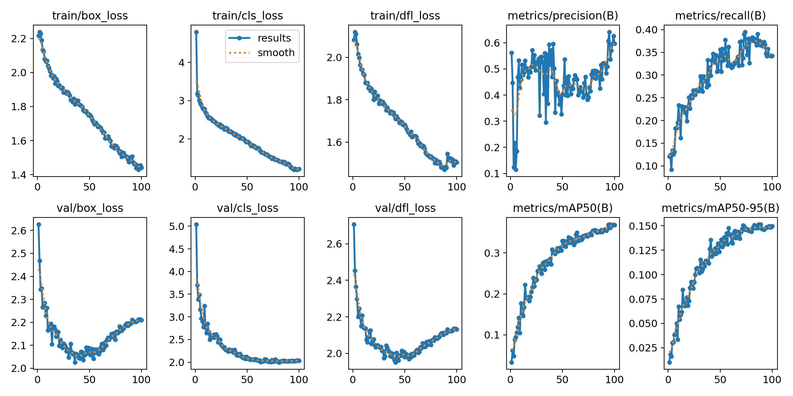
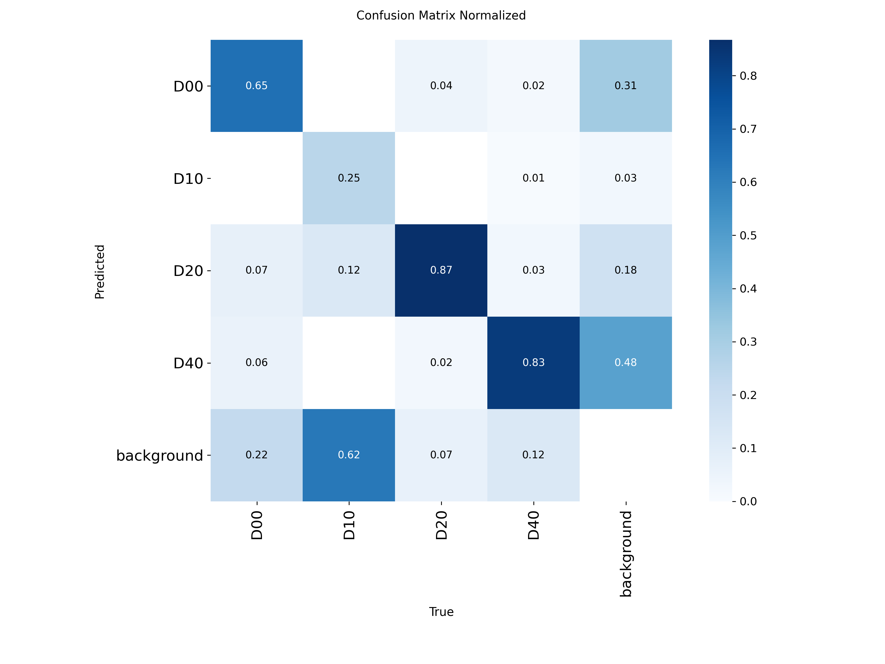
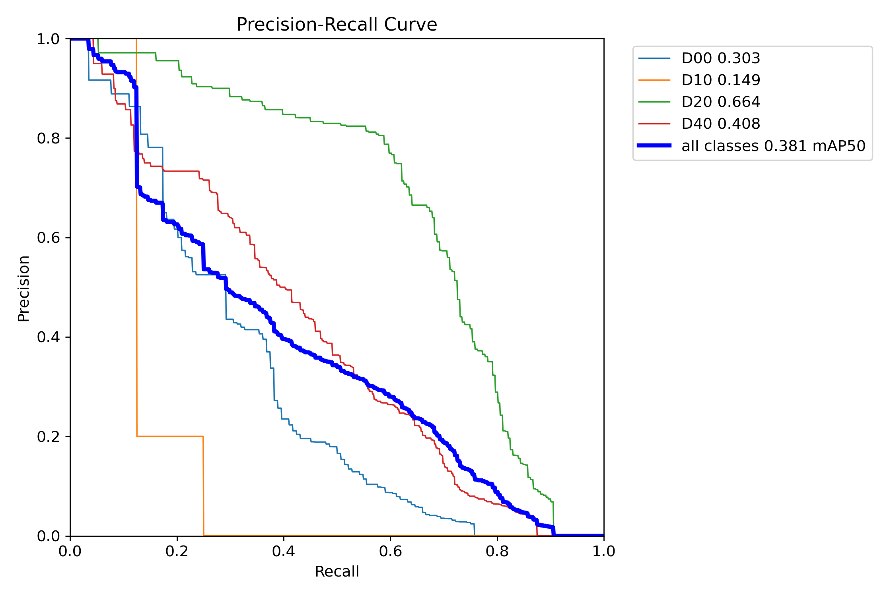
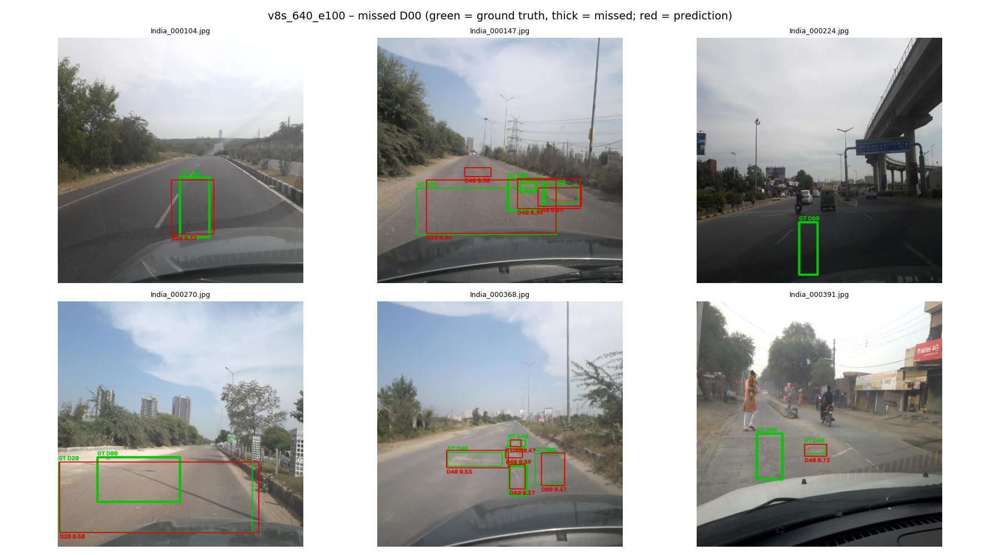
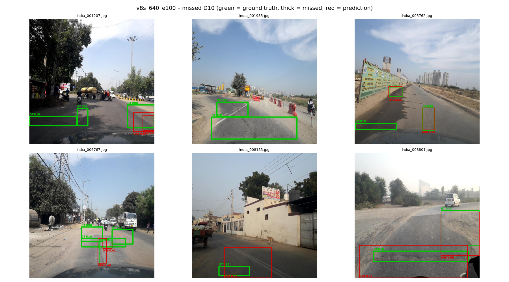
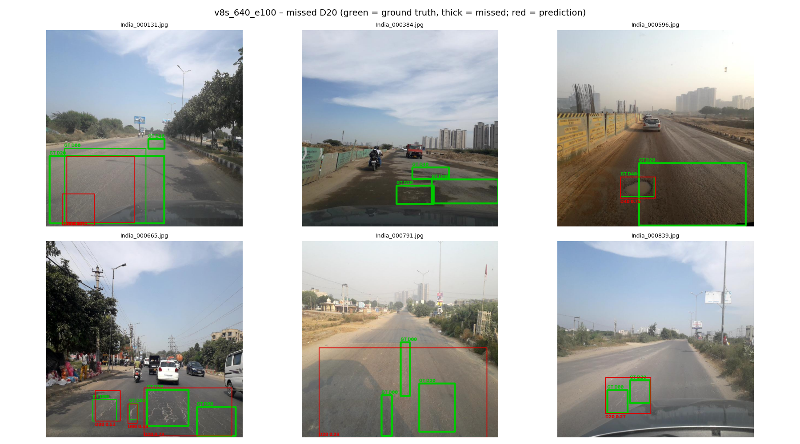
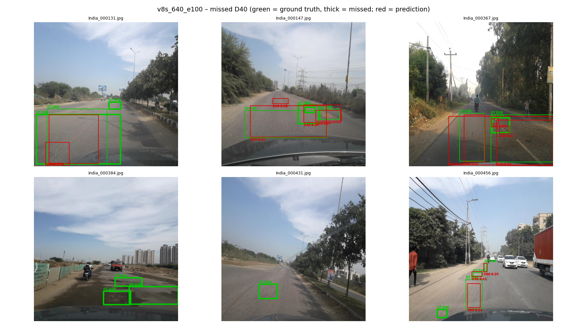

# RoadWatch – Model Evaluation Report

**Final model:** YOLOv8s, 640 px (`roadwatch_v1_v8s_640_e100.pt`)
**Run:** `v8s_640_e100` (`model_training/notebooks/02_finetune.ipynb`)
**Compared against:** YOLOv8n baseline `v8n_baseline` (`model_training/notebooks/01_baseline.ipynb`)

All numbers in this report come from the metrics JSON files in this folder or from the saved outputs of the two
notebooks. Test-set numbers are on the held-out **test split (714 images, 681 boxes)**.

---

## 1. Summary

**We choose YOLOv8s at 640 px.** Compared with the YOLOv8n baseline on the test split:

| | YOLOv8n (baseline) | **YOLOv8s (chosen)** | Change |
|---|---:|---:|---:|
| mAP50 | 0.3415 | **0.3807** | +0.0392 |
| mAP50-95 | 0.1476 | **0.1652** | +0.0176 |
| Precision | 0.3706 | **0.5641** | +0.1935 |
| Recall | 0.3870 | 0.3655 | −0.0215 |

Why:

- **Higher test mAP50 and mAP50-95**, and a higher test AP50 for **all four classes** (Section 3).
- **Much higher precision** (0.564 vs 0.371): far fewer false alarms at the operating point Ultralytics reports.
  Recall is slightly lower (0.366 vs 0.387), so it finds about the same share of damage but is wrong less often.
- The baseline's validation mAP50 was still rising at epoch 50; the larger model trained for 100 epochs and its
  validation mAP50 levelled off around 0.36–0.37 over the last epochs, so it was not stopped early by a short schedule.

Caveats: on the **validation** split the gain is only +0.010 mAP50 (Section 5), so the true size of the improvement
is uncertain. The model is also slow on a small CPU (~0.5 s per image, Section 6), and it still misses about half of
the ground-truth boxes at confidence 0.25 (Section 7).

## 2. Dataset

From the main `README.md` (prepared by Manasvi):

- **Source:** RDD2022, India subset; Pascal VOC XML annotations converted to YOLO format.
- **Dataset version used:** `RoadWatch_YOLO_Grouped` (group-aware split; config `dataset_pipeline/data_grouped.yaml`).
  Four visually confirmed near-duplicate image pairs are kept inside the same split.
- **Images:** 7,144 in total: 3,223 with damage and 3,921 negatives (no damage, empty label files).

| Split | Images | Positive | Negative |
|---|---:|---:|---:|
| Train | 5,001 | 2,256 | 2,745 |
| Validation | 1,429 | 645 | 784 |
| Test | 714 | 322 | 392 |

| ID | Class | Train boxes | Val boxes | Test boxes |
|---|---|---:|---:|---:|
| 0 | D00 – Longitudinal crack | 1,092 | 319 | 144 |
| 1 | D10 – Transverse crack | 47 | 13 | **8** |
| 2 | D20 – Alligator crack | 1,411 | 399 | 211 |
| 3 | D40 – Pothole | 2,260 | 609 | 318 |

The image counts were checked in both notebooks: 5001 / 1429 / 714 images with matching label files.

## 3. Experiments

Both runs: COCO-pretrained weights, image size 640, batch 16, seed 42, Google Colab Tesla T4, Ultralytics 8.4.216.

| | `v8n_baseline` | `v8s_640_e100` |
|---|---|---|
| Model | YOLOv8n | YOLOv8s |
| Parameters / GFLOPs (fused) | 3,133,436 / 8.6 | 11,127,132 / 28.4 |
| Epochs (max / completed) | 50 / 50 | 100 / 100 (no early stop, patience 20) |
| Training time (T4) | 1.178 h | 3.020 h |
| Extra settings | defaults | `cos_lr=True`, `hsv_v=0.5`, `fliplr=0.5`, `degrees=5`, `close_mosaic=10` |
| **Validation** mAP50 / mAP50-95 (best.pt) | 0.344 / 0.150 | 0.354 / 0.151 |
| **Test** mAP50 | 0.3415 | **0.3807** |
| **Test** mAP50-95 | 0.1476 | **0.1652** |
| **Test** precision | 0.3706 | **0.5641** |
| **Test** recall | **0.3870** | 0.3655 |
| Test AP50 – D00 | 0.2811 | **0.3025** |
| Test AP50 – D10 | 0.0396 | **0.1490** |
| Test AP50 – D20 | 0.6546 | **0.6636** |
| Test AP50 – D40 | 0.3905 | **0.4076** |

Training curves (v8s):



Test-split confusion matrix (normalised per true class; columns = true class) and precision-recall curve (v8s):





Baseline plots for comparison: [results](baseline_v8n_results.png) ·
[confusion matrix](baseline_v8n_confusion_matrix.png) · [PR curve](baseline_v8n_PR_curve.png).

## 4. Per-class discussion (v8s, test split)

| Class | Test boxes | AP50 | AP50-95 | Precision | Recall |
|---|---:|---:|---:|---:|---:|
| D00 – Longitudinal crack | 144 | 0.3025 | 0.1246 | 0.4642 | 0.2917 |
| D10 – Transverse crack | 8 | 0.1490 | 0.1048 | 0.6205 | 0.1250 |
| D20 – Alligator crack | 211 | **0.6636** | **0.2791** | 0.6776 | 0.6398 |
| D40 – Pothole | 318 | 0.4076 | 0.1522 | 0.4940 | 0.4057 |

- **D20 (alligator cracks) is the best class** by a wide margin (AP50 0.664). Alligator cracking covers large,
  textured areas that are easy to see. Its AP50-95 (0.279) is much lower than its AP50, so the model finds these
  areas but does not draw tight boxes; see the box-granularity issue in Section 7. (D20 AP50-95 is slightly *lower*
  than the baseline's 0.303 on the test split.)
- **D40 (potholes)** is the most common class (318 test boxes) but only reaches AP50 0.408. In the confusion matrix
  D40 is also where most false positives on background land (0.48 of the background column): shadows, patches and
  wet or dark areas get called potholes. Small, distant potholes are often missed (Section 7).
- **D00 (longitudinal cracks)** is weak: AP50 0.303, recall 0.292. These are thin lines running along the road,
  often faint and only a few pixels wide at 640 px. 0.22 of true D00 boxes end up as background in the confusion
  matrix, and 0.07 are predicted as D20.
- **D10 (transverse cracks) is not reliable.** Only **8** test boxes (and 47 training boxes) exist, so one more or one
  fewer detection changes recall by 0.125. The jump from 0.040 to 0.149 AP50 should not be read as a real improvement,
  and D10 results should not be reported without this caveat.

## 5. Validation vs test disagreement

| | Val mAP50 | Test mAP50 | Val AP50 D40 | Test AP50 D40 |
|---|---:|---:|---:|---:|
| v8n baseline | 0.344 | 0.3415 | 0.408 | 0.3905 |
| v8s | 0.354 | 0.3807 | 0.379 | 0.4076 |
| **v8s − v8n** | **+0.010** | **+0.039** | **−0.029** | **+0.017** |

On the validation split, v8s is only 0.010 mAP50 (and 0.001 mAP50-95) better than the baseline. On the test split
it is 0.039 mAP50 better. For single classes the two splits can even disagree on which model is better: D40 is
worse with v8s on validation but better on test. The same model also scores quite differently on the two splits
(v8s D20 AP50: 0.595 val vs 0.664 test).

**Conclusion:** differences of a few hundredths of mAP between these models are within the noise of a single
training run and splits of this size. v8s is better or equal on both splits overall, so it is a reasonable choice, but
the +0.039 test gain should not be presented as a precise improvement. A firmer comparison would need several seeds
per model or a larger test set.

## 6. CPU latency and model size

From `v8s_640_e100_cpu_benchmark.json`: Google Colab CPU, Intel Xeon @ 2.20 GHz, 2 logical cores, **1 PyTorch
thread**, image size 640, 50 test images timed one at a time after 5 warm-up images. Times are end to end
(pre-processing + model + post-processing).

| Format | File size | Mean ms / image | Median ms / image |
|---|---:|---:|---:|
| PyTorch `.pt` | 21.48 MB | 552.4 | 493.4 |
| ONNX `.onnx` | 42.68 MB | 490.6 | 439.8 |

- **ONNX is about 11 % faster** (mean) on this CPU. The ONNX file is about twice as large; this is most likely
  because the saved `.pt` weights are stored in half precision while the ONNX export is full precision.
- For comparison, GPU inference on the T4 during training validation was 4.5 ms per image (model only).
- This was a slow, single-thread cloud CPU. **Measure again on the real API server** before setting latency targets.
- **Video:** at roughly 0.5 s per frame (about 2 frames per second at most) on a CPU like this, running every frame
  of a normal video is not possible. The API should **sample frames** (a fixed number per second, or by distance
  travelled if GPS is available) and run detection only on those. Consecutive frames show mostly the same road anyway.

## 7. Missed-detection analysis

Method (02_finetune, section 10): `best.pt` was run on all 714 test images with **confidence ≥ 0.25**. A
ground-truth box counts as **detected** if a prediction of the **same class** overlaps it with **IoU ≥ 0.5**
(highest-confidence predictions matched first). Otherwise it is **missed**.

| Class | GT boxes | Detected | Missed | Miss rate |
|---|---:|---:|---:|---:|
| D00 | 144 | 51 | 93 | 64.6 % |
| D10 | 8 | 1 | 7 | 87.5 % |
| D20 | 211 | 139 | 72 | 34.1 % |
| D40 | 318 | 144 | 174 | 54.7 % |
| **Total** | **681** | **335** | **346** | **50.8 %** |

193 of the 714 test images contain at least one missed box.

These miss rates are much higher than the "background" row of the confusion matrix (e.g. D40: 0.12). The confusion
matrix uses Ultralytics' own matching, which accepts looser overlaps, so many boxes it counts as found fail the
stricter same-class IoU ≥ 0.5 rule here. That fits the first pattern below: much of the damage is seen but boxed
differently from the annotation.

In the grids below, **green** = ground truth (thick green = missed box) and **red** = predictions with confidence.

### Patterns seen in the grids

1. **D20 "misses" at a different box granularity.** Many missed D20 boxes are covered by a prediction, but the box
   size doesn't match the annotation, so IoU stays below 0.5. One large prediction often spans several smaller
   annotated boxes (`India_000791`: one D20 0.28 box across several ground-truth boxes; `India_000839`: one D20 0.27
   box covering two). In other cases a smaller prediction sits inside one large annotated region (`India_000131`).
   The same happens for D00 (`India_000270`: a D20 0.50 box spans the road, including the D00 crack). For a
   maintenance use case these detections still point at the right damage. The IoU metric counts them as misses.
2. **D40 / D20 confusion.** Potholes often sit inside or next to alligator-cracked areas, and the model mixes the two.
   `India_000367` has D40 predictions inside an annotated D20 area. `India_000147` has a large D20 prediction over a
   region that also contains D40 ground truth. `India_008801` (D10 grid) has overlapping D20 0.26 and D40 0.60
   predictions over cracked and potholed road. By count this confusion is small in the confusion matrix (true D40 →
   predicted D20: 0.03; true D20 → predicted D40: 0.02). It matters for damage-type reporting more than for the overall
   miss rate.
3. **Small or faint damage is missed.** Distant small potholes and thin, low-contrast cracks often get no
   prediction at all: `India_000431` and `India_000456` (small D40), `India_000224` and `India_000391` (thin D00),
   `India_001935` and `India_005762` (faint D10), and `India_000384`, where none of the boxes on a patchy, wet-looking
   road is found.

### D00 – Longitudinal crack



### D10 – Transverse crack



### D20 – Alligator crack



### D40 – Pothole



## 8. Limitations

From the dataset README, plus what this evaluation adds:

1. **D10 class imbalance.** Only 68 D10 boxes in the whole dataset (47 train, 8 test). D10 metrics are unstable and
   the model rarely predicts D10 correctly.
2. **Unlabelled excluded classes.** Images that also contain other RDD2022 damage types were kept, but those other
   damage types were not labelled. The model may learn to treat real damage as background, and correct-looking
   detections of such damage can be counted as false positives.
3. **Test split comes from the original training data.** The official RDD2022 test images have no annotations in this
   dataset. All results are on Indian roads from the same collection, so performance on other cities, countries or
   cameras is unknown.
4. **Possible near-duplicate leakage.** Only four visually confirmed near-duplicate pairs were kept within one split.
   Other candidates were not all checked, so test scores may be slightly optimistic.
5. **Single run per model.** Each model was trained once (seed 42); see Section 5 on how much results move between
   splits.
6. **Box granularity in annotations.** Annotators sometimes draw one large box and sometimes several small ones for
   the same type of damage. IoU-based metrics penalise the model for this (Section 7), so mAP understates how often
   damage is actually found.

## 9. Handover for the API

| Item | Value |
|---|---|
| Weights file | `roadwatch_v1_v8s_640_e100.pt`. Not in git: it is exported by section 12 of `02_finetune.ipynb` (a copy of `runs/v8s_640_e100/weights/best.pt` on the team Google Drive). |
| ONNX (optional) | `best.onnx` in the same Drive `weights/` folder (42.68 MB, about 11 % faster on CPU) |
| Framework | Ultralytics **8.4.x** (trained with 8.4.216, evaluated with 8.4.218) |
| Input size | **640** (`imgsz=640`); pass the original image, Ultralytics resizes and letterboxes it |
| Classes (index order) | `['D00', 'D10', 'D20', 'D40']`: 0 longitudinal crack, 1 transverse crack, 2 alligator crack, 3 pothole |
| Confidence threshold | **0.25** suggested default (the threshold used in the missed-detection analysis). Lower it for higher recall when missed damage costs more than false alarms; raise it to cut false potholes. The best value has not been tuned yet. |
| Output | Per box: class index, confidence, `xyxy` pixel coordinates in the original image |
| Expected CPU speed | ≈ 0.5 s per image on a 2-core Colab CPU (Section 6); sample video frames rather than running every frame |

Minimal usage:

```python
from ultralytics import YOLO

model = YOLO('roadwatch_v1_v8s_640_e100.pt')
result = model.predict('road.jpg', imgsz=640, conf=0.25, verbose=False)[0]
for cls, conf, box in zip(result.boxes.cls.tolist(), result.boxes.conf.tolist(), result.boxes.xyxy.tolist()):
    print(['D00', 'D10', 'D20', 'D40'][int(cls)], round(conf, 2), [round(v) for v in box])
```

Notes for the API team:

- **D10 predictions** are rare and unreliable (Section 4); consider showing them as "crack" or flagging them for review.
- Expect **several overlapping or nested boxes** on heavily damaged road (Section 7). Merging boxes or reporting
  "damaged area" per image may be more useful than counting boxes.
